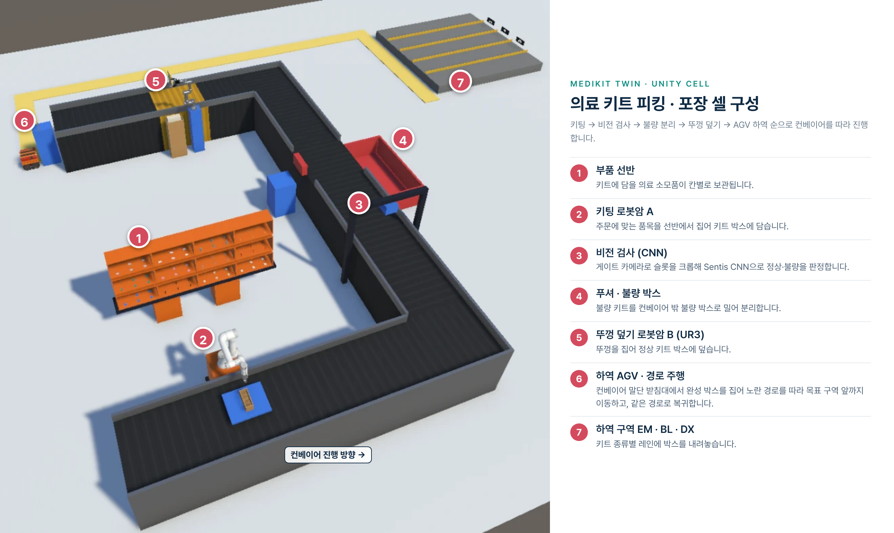
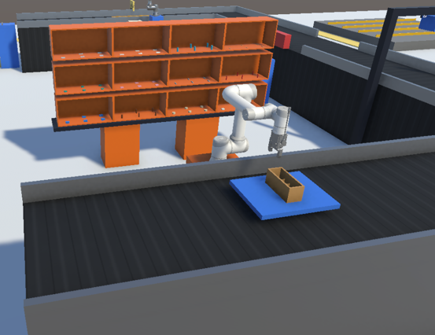
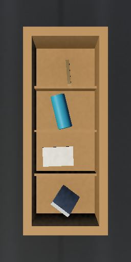
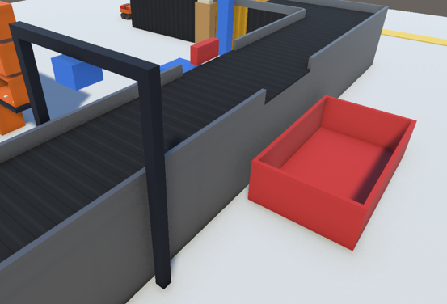
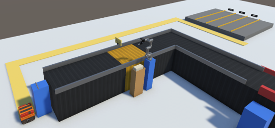
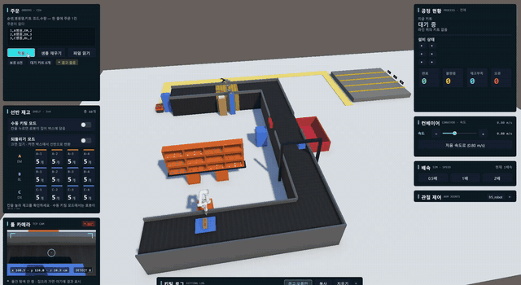

<div align="center">

 🏭 MediKit 

**병원 맞춤형 의료 키트 피킹·포장 공정을 Unity에서 재현하는 시뮬레이션**

주문 CSV를 읽어 키트를 만들고, 로봇이 구성품을 담아 검사·포장·라벨·하역까지 한 셀 안에서 처리합니다.

</div>

<br/>

📌 프로젝트 소개

주문 CSV(순번, 병원명, 키트 코드, 수량)를 읽어 키트(**EM / BL / DX**) 단위로 풀고, 로봇암이 자재 선반에서 구성품을 집어 키트 박스에 담습니다. 박스는 컨베이어로 이동해 CNN 검사를 받고, 정상 박스는 뚜껑 덮기와 라벨 부착을 거쳐 AGV가 하역장으로 옮깁니다. 불량 박스는 푸셔가 밀어 불량 박스에 모읍니다.

<table>
<thead>
<tr><th align="left">항목</th><th align="left">내용</th></tr>
</thead>
<tbody><tr><td align="left">목적</td><td align="left">의료 키트 포장 공정 전체를 가상 셀로 재현하고 검사 CNN까지 시험</td></tr></tbody>
<tbody><tr><td align="left">엔진</td><td align="left">Unity 6000.6.0f1, URP 17.6</td></tr></tbody>
<tbody><tr><td align="left">로봇</td><td align="left">로봇암 A(FR5), 로봇암 B(UR3), 하역 AGV</td></tr></tbody>
<tbody><tr><td align="left">검사</td><td align="left">슬롯 크롭 CNN(ONNX, Sentis 추론) + 규칙 판정</td></tr></tbody>
<tbody><tr><td align="left">팀</td><td align="left">AURIX Robotics (2인)</td></tr></tbody>
<tbody><tr><td align="left">요구사항</td><td align="left"><a href="docs/AURIX_SRS.docx">AURIX_SRS.docx</a> — 코드와 문서의 <code>FR-xx</code>, <code>NFR-xx</code>는 이 SRS의 ID</td></tr></tbody>
</table>

<br/>

👥 팀 구성 및 역할

<table>
<thead>
<tr>
    <th nowrap>담당자</th>
    <th nowrap>담당 파트</th>
    <th>주요 기여</th>
  </tr>
</thead>
<tbody><tr>
    <td align="center" nowrap>도희정</td>
    <td align="center" nowrap>비전 검사 · 불량 배출 ·<br>팩킹 · 하역</td>
    <td>공통 인터페이스·레시피 설계, 검사 카메라와 합성 데이터셋·슬롯 크롭 CNN 학습(ONNX), 푸셔·불량 박스, 로봇암 B(UR3) 뚜껑 덮기와 팩킹 실패 처리, 하역 AGV와 하역장 구역</td>
  </tr></tbody>
<tbody><tr>
    <td align="center" nowrap>최치언</td>
    <td align="center" nowrap>주문 · 키팅 ·<br>컨베이어 · 대시보드</td>
    <td>주문 적용, 로봇암 A(FR5) 키팅(IK·집기·놓기·이동 베이스), 컨베이어 이송·속도 조절, 라벨 설비, uGUI 대시보드, 배속·전체 공정(E2E) 시험</td>
  </tr></tbody>
</table>

<br/>

🎯 핵심 기능

<table>
<thead>
<tr><th align="left">기능</th><th align="left">내용</th></tr>
</thead>
<tbody><tr><td align="left">📋 주문 처리</td><td align="left">CSV 주문을 키트 단위로 풀고, 재고가 모자라면 주문을 보류했다가 보충 후 맨 앞에서 재개</td></tr></tbody>
<tbody><tr><td align="left">📦 재고 관리</td><td align="left">자재 선반 12칸의 재고를 세고, 소진되면 30초 뒤 자동 보충</td></tr></tbody>
<tbody><tr><td align="left">🦾 키팅</td><td align="left">이동 베이스 위의 로봇암 A(FR5)가 선반에서 집어 키트 박스 슬롯에 배치</td></tr></tbody>
<tbody><tr><td align="left">🔍 CNN 검사</td><td align="left">슬롯별 크롭을 빈 슬롯 또는 구성품 12종으로 분류하고 박스 단위로 정상/불량 판정</td></tr></tbody>
<tbody><tr><td align="left">🧱 불량 배출</td><td align="left">불량 박스를 푸셔가 밀어 불량 박스(RejectBin)에 모음</td></tr></tbody>
<tbody><tr><td align="left">🏷 팩킹·라벨</td><td align="left">로봇암 B(UR3)가 뚜껑을 덮고, 뚜껑이 닫히면 키트 라벨 자동 표시</td></tr></tbody>
<tbody><tr><td align="left">🚚 하역</td><td align="left">AGV가 컨베이어 끝의 박스를 집어 하역장의 키트별 구역에 내려놓음</td></tr></tbody>
<tbody><tr><td align="left">📊 대시보드</td><td align="left">공정 현황, 주문, 재고, 로그, 배속, 카메라 패널</td></tr></tbody>
</table>

<br/>

🖼 시뮬레이션 화면

Unity 셀 전체 모습입니다. 키팅 → 비전 검사 → 불량 분리 → 뚜껑 덮기 → AGV 하역 순으로 컨베이어를 따라 진행합니다.

<div align="center">
  
</div>

<br/>

```
주문(CSV) → 키팅(로봇암 A) → 컨베이어 → 검사(CNN) ─정상→ 팩킹(로봇암 B, 뚜껑) → 라벨 → 컨베이어 끝 → 하역(AGV) → 하역장
                                              └─불량→ 푸셔 → 불량 박스(RejectBin)
```

<table>
<thead>
<tr><th align="left">공정</th><th align="left">하는 일</th><th align="left">주요 코드</th></tr>
</thead>
<tbody><tr><td align="left">주문</td><td align="left">CSV를 읽어 키트 단위로 풀고, 재고가 모자라면 주문을 보류</td><td align="left"><code>Scripts/Orders</code>, <code>Scripts/Recipes</code></td></tr></tbody>
<tbody><tr><td align="left">재고</td><td align="left">자재 선반 12칸의 재고를 셈</td><td align="left"><code>Scripts/Inventory</code></td></tr></tbody>
<tbody><tr><td align="left">키팅</td><td align="left">로봇암 A(FR5)가 선반에서 집어 키트 박스 슬롯에 놓음</td><td align="left"><code>Scripts/ArmA</code>, <code>Scripts/Mobile</code></td></tr></tbody>
<tbody><tr><td align="left">컨베이어</td><td align="left">박스를 검사, 팩킹, 끝 구간으로 이동</td><td align="left"><code>Scripts/Conveyor</code></td></tr></tbody>
<tbody><tr><td align="left">검사</td><td align="left">슬롯별 크롭을 CNN으로 분류해 정상/불량 판정(규칙 판정도 지원)</td><td align="left"><code>Scripts/Inspection</code>, <code>Scripts/ML</code></td></tr></tbody>
<tbody><tr><td align="left">푸셔</td><td align="left">불량 박스를 밀어 불량 박스에 넣음</td><td align="left"><code>Scripts/Pusher</code></td></tr></tbody>
<tbody><tr><td align="left">팩킹</td><td align="left">로봇암 B(UR3)가 뚜껑을 집어 덮음</td><td align="left"><code>Scripts/ArmB</code></td></tr></tbody>
<tbody><tr><td align="left">라벨</td><td align="left">뚜껑에 키트 라벨을 붙임</td><td align="left"><code>Scripts/Label</code></td></tr></tbody>
<tbody><tr><td align="left">하역</td><td align="left">AGV가 박스를 하역장의 키트별 구역(EM, BL, DX)에 내려놓음</td><td align="left"><code>Scripts/Unloader</code></td></tr></tbody>
<tbody><tr><td align="left">대시보드</td><td align="left">공정 현황, 주문, 재고, 로그, 배속, 카메라 패널</td><td align="left"><code>Scripts/Dashboard</code>, <code>Scripts/Demo</code></td></tr></tbody>
</table>

<br/>

<table>
<thead>
<tr><th align="center">키팅 (로봇암 A)</th><th align="center">검사 슬롯</th></tr>
</thead>
<tbody><tr><td align="center"></td><td align="center"></td></tr></tbody>
<tbody><tr><td align="center">선반에서 구성품을 집어 지그 위 키트 박스 슬롯에 담음</td><td align="center">키트 박스 슬롯을 크롭해 CNN으로 정상·불량 판정</td></tr></tbody>
</table>

<table>
<thead>
<tr><th align="center">불량 배출 (푸셔)</th><th align="center">하역 (AGV)</th></tr>
</thead>
<tbody><tr><td align="center"></td><td align="center"></td></tr></tbody>
<tbody><tr><td align="center">불량 키트를 컨베이어 밖 불량 박스로 밀어 분리</td><td align="center">컨베이어 끝에서 박스를 집어 경로를 따라 하역장으로 이동</td></tr></tbody>
</table>

<br/>

🎬 시연 영상

주문을 받아 키팅, 검사, 팩킹, 하역까지 한 셀을 처리하는 과정입니다. 오른쪽 대시보드에서 공정 현황과 재고를 함께 볼 수 있습니다.

<p align="center">
  
</p>

🎬 [시연 영상 전체 보기 (YouTube)](https://www.youtube.com/watch?v=0DOmODBqz7Q)

<br/>

🏗 공정 구조

<div align="center">
  
</div>

<br/>

🧩 설계 규칙

- **신호로만 소통**: 설비끼리 직접 참조하지 않고 `CellEvents`의 신호(`KitReady`, `AtInspection`, `InspectionResult`, `KitShipped` 등)로만 주고받습니다. 신호 목록은 [INTERFACES.md](docs/INTERFACES.md)에 있습니다.
- **시뮬레이션 시간**: 시간은 모두 `SimClock`(배속 반영)을 따릅니다. 예외는 설비 주기 통지입니다.
- **판정의 단일 출처**: 키트 판정 결과의 출처는 `KitData.Verdict` 하나입니다.
- **재현성**: 같은 시드와 같은 주문 파일은 같은 결과를 냅니다(NFR-06).

<br/>

🛠 기술 스택

<table>
<thead>
<tr><th align="left">영역</th><th align="left">스택</th></tr>
</thead>
<tbody><tr><td align="left">시뮬레이션</td><td align="left">Unity 6000.6.0f1, URP 17.6, Input System 1.20</td></tr></tbody>
<tbody><tr><td align="left">추론</td><td align="left"><code>com.unity.ai.inference</code> 2.6.1 (Sentis, ONNX)</td></tr></tbody>
<tbody><tr><td align="left">로봇 모델</td><td align="left">URDF Importer v0.5.2, FR5 / UR3</td></tr></tbody>
<tbody><tr><td align="left">CNN 학습</td><td align="left">Python 3.9~3.13, PyTorch, 합성 데이터셋</td></tr></tbody>
<tbody><tr><td align="left">시험</td><td align="left">Unity Test Runner (EditMode / PlayMode, 모듈별 어셈블리)</td></tr></tbody>
</table>

<br/>

📚 문서

<table>
<thead>
<tr><th align="left">문서</th><th align="left">설명</th></tr>
</thead>
<tbody><tr><td align="left"><a href="docs/README.md">docs/README.md</a></td><td align="left">상세 안내 — 요구 환경, 폴더 구조, 에디터 도구, 시험, 협업 규칙 (기존 README)</td></tr></tbody>
<tbody><tr><td align="left"><a href="docs/INTERFACES.md">INTERFACES.md</a></td><td align="left">공통 인터페이스(CellEvents, KitData, RecipeSO)</td></tr></tbody>
<tbody><tr><td align="left"><a href="docs/TROUBLESHOOTING.md">TROUBLESHOOTING.md</a></td><td align="left">만난 문제와 원인 · 해결 (상세 기록은 <code>docs/troubleShooting/</code>)</td></tr></tbody>
<tbody><tr><td align="left"><a href="MLTraining/README.md">MLTraining/README.md</a></td><td align="left">CNN 학습과 성능 측정</td></tr></tbody>
<tbody><tr><td align="left"><a href="COMMIT_RULES.md">COMMIT_RULES.md</a></td><td align="left">브랜치 전략 · 커밋 메시지 · PR 규칙</td></tr></tbody>
<tbody><tr><td align="left"><a href="CONVENTION.md">CONVENTION.md</a></td><td align="left">협업, 씬, 코딩 컨벤션</td></tr></tbody>
</table>

<br/>

🚀 빠른 시작

```bash
git clone https://github.com/postwo/MediKit.git
cd MediKit
git config core.hooksPath .githooks   # 커밋 규칙 자동 검사
```

1. Unity Hub에서 이 폴더를 엽니다(에디터 6000.6.0f1). 처음 열 때 패키지를 받느라 시간이 걸립니다.
2. `Assets/_Project/Scenes/Scene_Cell.unity`를 엽니다. 공정 전체가 이 씬 하나에 있습니다.
3. Play를 누릅니다. 주문은 `Assets/StreamingAssets/Orders/orders.csv`를 읽습니다.

주문 CSV는 첫 줄이 머리글이고 열은 `순번,병원명,키트 코드,수량`입니다.

```csv
순번,병원명,키트 코드,수량
1,A병원,EM,2
2,B병원,DX,3
3,C병원,BL,4
```

시나리오(누락 확률, 설비 실패 키트, 난수 시드, 재고)는 `Assets/_Project/Config/ScenarioConfig_Default.asset`에서 바꿉니다. 폴더 구조, 에디터 도구, 시험 방법은 [docs/README.md](docs/README.md)를 참고하세요.
